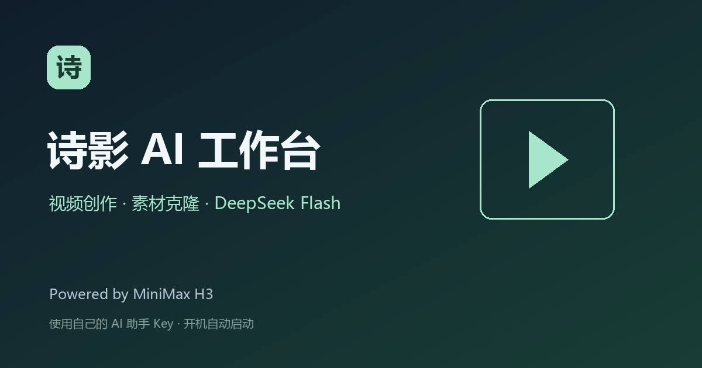

# 诗影 AI 工作台

视频创作与素材克隆的一体化网页工作台。**Powered by MiniMax H3**。



## 功能

- H3 视频创作：文字、图片及多参考素材输入，支持设置分辨率、时长、步数与 Seed。
- 素材克隆：上传视频与参考图片，用文字指定替换对象；通过用户自己的 DeepSeek Flash 分析素材并编译指令。
- 任务队列、作品预览与下载，保留原始生成结果。
- AutoDL 开机自启，根据当前实例平台地址处理公网域名和端口，兼容镜像迁移。

本发行版为视频/克隆版，不包含 Qwen-Image 2.1 图片生成模型或服务。人物替换为生成式编辑，结果受素材、动作、遮挡及参数影响。

## 使用 AutoDL 镜像

1. 从本应用页面创建实例，保留平台配置的公共模型挂载和开机命令。
2. 等服务就绪后打开平台提供的工作台访问地址。不同实例域名由 AutoDL 分配，无需填写旧域名。
3. 点击首页“AI 助手配置”，在当前实例终端执行：

   ```bash
   cd /root/minimax-node
   venv/bin/python -m app.public_release admin-code
   ```

4. 在配置页填写管理码和自己的 DeepSeek API Key，验证并保存。首次配置默认使用 `deepseek-flash`，地址为 `https://api.deepseek.com/v1`，调用费用由使用者账户承担。首页“实例设置”可用管理码解锁完整设置，管理生成参数、助手和超分；退出后重新锁定。
5. 返回工作台进行视频创作或克隆。建议先用低分辨率、短片段验证素材，再提高输出规格。

Key 加密保存在本实例后端目录，服务重启可继续使用。管理码随新实例更新。发行镜像不携带发布者的个人 Key、私人监控凭据或用户任务；默认不向发布者服务器上报节点信息。

桌面工作台连接本算力节点时，提示词优化由节点助手配置执行，不会自动继承桌面的本地助手 Key。

## 运行环境

- NVIDIA GPU、Linux、AutoDL 应用端口 6008；后端 API 7890、ComfyUI 8188 均在本机通信。
- CUDA / PyTorch / ComfyUI 运行环境由应用系统镜像提供；本仓库仅包含应用源码、完整依赖清单、部署与启动脚本。
- H3 的模型权重体积较大。建议挂载 AutoDL 公共模型 `Comfy-Org/MiniMax-H3`，脚本会校验 SHA-256 后复用文件。没有公共挂载时，需为模型准备足够存储，不能仅凭 30GB 系统盘下载全部权重。
- 建议 32GB 及以上显存；实际可用规格与速度取决于模型、分辨率、时长和运行时的显存保护。更低显存使用需自行测试。
- 超分提供节点上的 Real-ESRGAN；本公开版未提供 Windows Topaz 回传处理。

## 源码和部署

源码包可用于审阅和维护当前镜像。已有配套运行环境的镜像内，源目录固定为 `/root/minimax-node`，启动入口为：

```bash
bash /root/minimax-node/deployment/start-node.sh
```

应用镜像中的平台开机命令保留为：

```bash
bash /root/zealman-app/scripts/improved-autostart.sh
```

从任意空白 Linux 直接安装时，还需先准备匹配的 CUDA/PyTorch、ComfyUI、系统工具和模型存储。本源码包不包含这些大型运行环境。完整 H3 依赖快照与自动补齐逻辑保留在 `scripts/h3-dependencies.json` 和 `app/h3_dependencies.py`。

镜像中的旧路径是兼容启动入口，内部调用本项目启动脚本；网关已使用自身锁定的 npm 依赖，不依赖旧底座应用代码。可运行只读环境验收：

```bash
cd /root/minimax-node
venv/bin/python scripts/public_smoke_check.py --factory
```

重新制作公开镜像前，请按 [镜像发布说明](docs/发布说明.md) 清理个人配置与测试数据。

## 许可与使用范围

模型由 MiniMax 提供，应用集成不改变模型许可。本包保留 MiniMax H3 Community License 全文和来源；使用需遵守其中的适用地区、用途限制、再分发和商业条件。界面显示 MiniMax H3 标识。其他组件按各自许可证使用。

本仓库不包含模型权重。发布者未将上游模型或算法论文声明为原创；代码原创认定和平台收益以 AutoDL.Art 审核为准。

缺陷与涉嫌违规内容可通过本仓库 Issues 联系维护者。提交时请勿上传 API Key、SSH 密码或带个人素材的完整日志。
